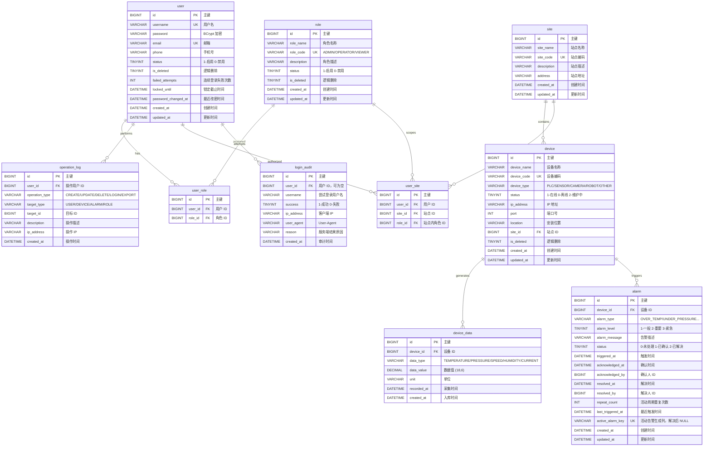

# Industrial AI Hub — 数据库 ER 图

> 数据库：`reboot` | 字符集：utf8mb4 | 引擎：InnoDB
> 版本：V2.3 | 更新：2026-10-18 | 当前 Schema：V16
> 迁移链：V1 基线 → V3 CHECK 扩展 → V4 站点授权 → V5 用户安全状态 → V6 登录审计 → V7 alarm/role 审计字段 → V8 admin 密码更新 → V9-V15 AI/RAG/MCP/巡检/SSE 审计类型扩展 → V16 活动告警聚合

> **说明**：下方 ER Diagram 以当前 V16 主动字段为主；历史迁移与 V16 专属索引见 [§ 迁移演进](#迁移演进) 和 [§ V16 活动告警聚合](#v16-活动告警聚合adr-0038)。

## ER Diagram

## 索引设计

| 表 | 索引 | 类型 | 覆盖查询 |
|----|------|:---:|------|
| `user` | `PRIMARY(id)` | 聚簇 | findById |
| | `uk_username` | 唯一 | findByUsername |
| | `uk_email` | 唯一 | — |
| | `idx_is_deleted` | 普通 | is_deleted=0 |
| `role` | `PRIMARY(id)` | 聚簇 | findById |
| | `uk_role_code_deleted` | 唯一 | role_code + is_deleted |
| | `idx_role_status` | 普通 | status=? |
| `user_role` | `PRIMARY(id)` | 聚簇 | findById |
| | `uk_user_role` | 唯一 | user_id + role_id |
| | `idx_user_id` | 普通 | user_id=? |
| | `idx_role_id` | 普通 | role_id=? |
| `site` | `PRIMARY(id)` | 聚簇 | findById |
| | `uk_site_code` | 唯一 | site_code=? |
| `user_site` | `PRIMARY(id)` | 聚簇 | findById |
| | `uk_user_site` | 唯一 | user_id + site_id |
| | `idx_user_id` | 普通 | user_id=? |
| | `idx_site_id` | 普通 | site_id=? |
| `device` | `PRIMARY(id)` | 聚簇 | findById |
| | `uk_device_code_deleted` | 唯一 | device_code + is_deleted |
| | `idx_device_type` | 普通 | findByType |
| | `idx_status` | 普通 | status=? |
| | `idx_is_deleted` | 普通 | is_deleted=0 |
| | `idx_device_site_id` | 普通 | site_id=? |
| `device_data` | `PRIMARY(id)` | 聚簇 | — |
| | `idx_device_id` | 普通 | device_id=? |
| | `idx_recorded_at` | 普通 | ORDER BY recorded_at |
| | `idx_device_type_time` | 复合 | device_id+data_type+recorded_at |
| `alarm` | `PRIMARY(id)` | 聚簇 | — |
| | `idx_device_id` | 普通 | device_id=? |
| | `idx_alarm_level` | 普通 | alarm_level=? |
| | `idx_status` | 普通 | status=? |
| | `idx_triggered_at` | 普通 | ORDER BY triggered_at |
| | `idx_alarm_acknowledged_by` | 普通 | acknowledged_by=? |
| | `uk_alarm_active_device_type` | 唯一 | 活动告警按 device_id+alarm_type 合并 |
| | `idx_alarm_last_triggered_at` | 普通 | 按最近触发时间排序 |
| `operation_log` | `PRIMARY(id)` | 聚簇 | — |
| | `idx_user_id` | 普通 | userId=? |
| | `idx_operation_type` | 普通 | — |
| | `idx_created_at` | 普通 | ORDER BY created_at |
| `login_audit` | `PRIMARY(id)` | 聚簇 | — |
| | `idx_login_audit_user_time` | 复合 | user_id + created_at |
| | `idx_login_audit_created_time` | 普通 | ORDER BY created_at |

## 表规模

| 表 | 列数 | 约束(CHECK) | 索引 |
|----|:---:|:---:|:---:|
| `user` | 12 | 1 (status) | 4 |
| `role` | 8 | 0 | 3 |
| `user_role` | 3 | 0 | 4 |
| `site` | 7 | 0 | 2 |
| `user_site` | 4 | 0 | 4 |
| `device` | 12 | 2 (status, device_type) | 6 |
| `device_data` | 7 | 1 (data_type) | 4 |
| `alarm` | 16 | 2 (level, status) | 8 |
| `operation_log` | 8 | 2 (operation_type, target_type) | 4 |
| `login_audit` | 8 | 0 | 3 |
| **合计** | **85** | **8** | **42** |

## 迁移演进

> 以 `backend/src/main/resources/db/migration/` 为唯一事实源；V2 已退役，当前活动链为 V1 + V3-V16。

### V4 站点授权（[ADR 0020](../decision-log/0020-site-authorization.md)）

| 新增表 | 关键字段 |
|--------|---------|
| `site` | id / site_code / site_name / description / created_at / updated_at |
| `user_site` | id / user_id / site_id / role_id / created_at |

| 表 | 新增字段 |
|----|---------|
| `device` | `site_id` BIGINT（DEFAULT 1，归属默认站点） |

### V5 用户安全状态

| 表 | 新增字段 |
|----|---------|
| `user` | `failed_attempts` INT（连续登录失败计数） |
| `user` | `locked_until` DATETIME（锁定截止时间） |
| `user` | `password_changed_at` DATETIME（最近改密时间） |

### V6 登录审计

| 新增表 | 关键字段 |
|--------|---------|
| `login_audit` | id / user_id / login_time / ip / user_agent / success / failure_reason / created_at |

### V7 alarm/role 审计字段

| 表 | 新增字段 |
|----|---------|
| `alarm` | `acknowledged_at` / `acknowledged_by` / `resolved_by` / `updated_at` |
| `role` | `status` TINYINT / `is_deleted` TINYINT / `updated_at` |
| `device` | 唯一约束由 `uk_device_code` 改为 `uk_device_code_deleted (device_code, is_deleted)`（支持软删后复用编码） |

### V8 admin 密码更新

仅数据变更，无结构变更。

### V9-V15 审计枚举扩展

| 版本 | 结构变更 |
|------|----------|
| V9 | `chk_operation_type` 增加 `CHAT/SUMMARY/DIAGNOSE`，`chk_target_type` 增加 `AI` |
| V10 | `chk_operation_type` 增加 `FUNCTION_CALL` |
| V11 | `chk_operation_type` 增加 `INGEST`，`chk_target_type` 增加 `KNOWLEDGE` |
| V12 | `chk_operation_type` 增加 `MCP_SMOKE`，`chk_target_type` 增加 `MCP` |
| V13 | `chk_operation_type` 增加 `INSPECTION` |
| V14 | `chk_operation_type` 增加 `PUSH`，`chk_target_type` 增加 `SSE` |
| V15 | `chk_operation_type` 增加 `AUTO_ALARM` |

### V16 活动告警聚合（[ADR 0038](../decision-log/0038-active-alarm-aggregation.md)）

| 变更 | 说明 |
|------|------|
| `alarm.repeat_count` | `INT NOT NULL DEFAULT 1`，活动周期内重复触发次数 |
| `alarm.last_triggered_at` | `DATETIME NOT NULL DEFAULT CURRENT_TIMESTAMP`，最近触发时间 |
| `alarm.active_alarm_key` | `VARCHAR(96) STORED GENERATED`；`status IN (0,1)` 时为 `device_id:alarm_type`，解决后为 `NULL` |
| `uk_alarm_active_device_type` | `active_alarm_key` 唯一索引，由数据库兜底并发合并 |
| `idx_alarm_last_triggered_at` | 支持活动告警按最近触发时间查询 |

V16 执行时会先归并存量活动重复项：保留最早 ID，其余标记为已解决并保留历史记录，然后创建唯一索引。解决后唯一键变为 `NULL`，同设备同类型再次触发会开启新活动周期。

## 当前总规模

| 维度 | V1 基线 | V16 当前 |
|------|:------:|:-----------:|
| 表数 | 7 | 10 |
| 列数 | 53 | 85 |
| CHECK 约束 | 8 | 8 |
| 索引 | 27 | 42 |
| 活动迁移 | V1 | V1 + V3-V16（15 个；V2 已退役，见 ADR 0019） |
